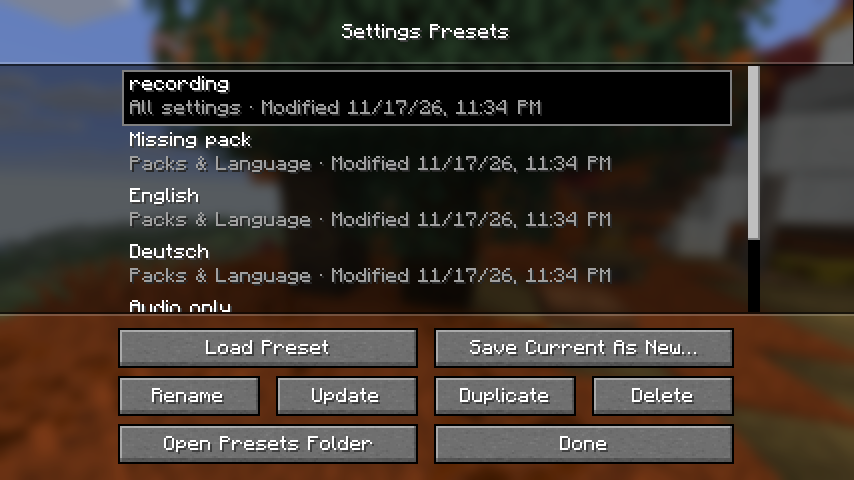
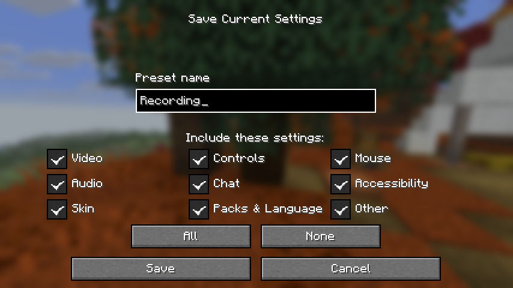

# Settings Presets

A client-side Fabric mod for Minecraft Java Edition **26.3**. It saves your vanilla settings as named presets ("PvP", "Recording", "Low-end laptop", …) and loads one back with a single click. Changes apply immediately, with no restart.



## Features

- **Save** the current settings under a name. You can choose which categories go into the preset: Video, Controls (keybinds, including those added by other mods), Mouse, Audio, Chat, Accessibility, Skin, Packs & Language, Other.
- **Load** a preset. Only the keys stored in the preset change, so an Audio-only preset leaves your keybinds alone. Most settings take effect right away: GUI scale, volumes, keybinds, render distance, fullscreen, language and resource packs. Resources reload at most once.
- **Manage** presets with Rename, Update (overwrite with the current settings), Duplicate and Delete. Update and Delete ask for confirmation, and saving under an existing name asks before overwriting.
- **Entry points**:
  - an icon button in the top-left corner of the vanilla Options screen
  - an unbound "Open Settings Presets" keybind (category *Settings Presets*)
  - Mod Menu's *Configure* button (optional)
- If a preset refers to a resource pack that no longer exists, the pack is skipped and a toast lists it.
- Built from vanilla widgets only, so the screens look like the rest of the game's menus. Translations: English and German.



## Where presets are stored

`<game dir>/config/settingspresets/<name>.json`. There is one human-readable JSON file per preset, and values are stored exactly as they appear in `options.txt`. Use the **Open Presets Folder** button to get there. The display name is stored inside the file, so renaming a preset doesn't change its file name.

Before every load the mod copies `options.txt` to `config/settingspresets/.backup/` and keeps the last five copies. If applying fails, that copy is restored.

A few keys are never stored or overwritten because they are per-install state, not preferences: `version`, `lastServer`, `tutorialStep`, `joinedFirstServer`, `skipMultiplayerWarning`, `onboardAccessibility` and `startedCleanly`.

Presets saved on an older game version are upgraded with the game's own options data fixer when they are loaded.

## Requirements

- Minecraft 26.3, Fabric Loader ≥ 0.20.1, Fabric API, Java 25
- Mod Menu is optional

## Building

```sh
./gradlew build                 # jar in build/libs/
./gradlew test                  # unit tests (no game needed)
./gradlew runClientGameTest     # in-game tests; screenshots in build/run/clientGameTest/screenshots
./gradlew runClientGameTest -PnoModMenu   # same, without Mod Menu installed
```

Gradle downloads a Java 25 JDK on its own if none is installed (see `gradle/gradle-daemon-jvm.properties`).

## Known limitations

- Changing *High Contrast* and resource packs in the same preset can trigger two resource reloads, because vanilla's High Contrast toggle reloads packs by itself.
- Graphics API changes (OpenGL/Vulkan) are saved and restored, but like in vanilla they only take effect after a restart.
- The mod icon is the Fabric example placeholder.
